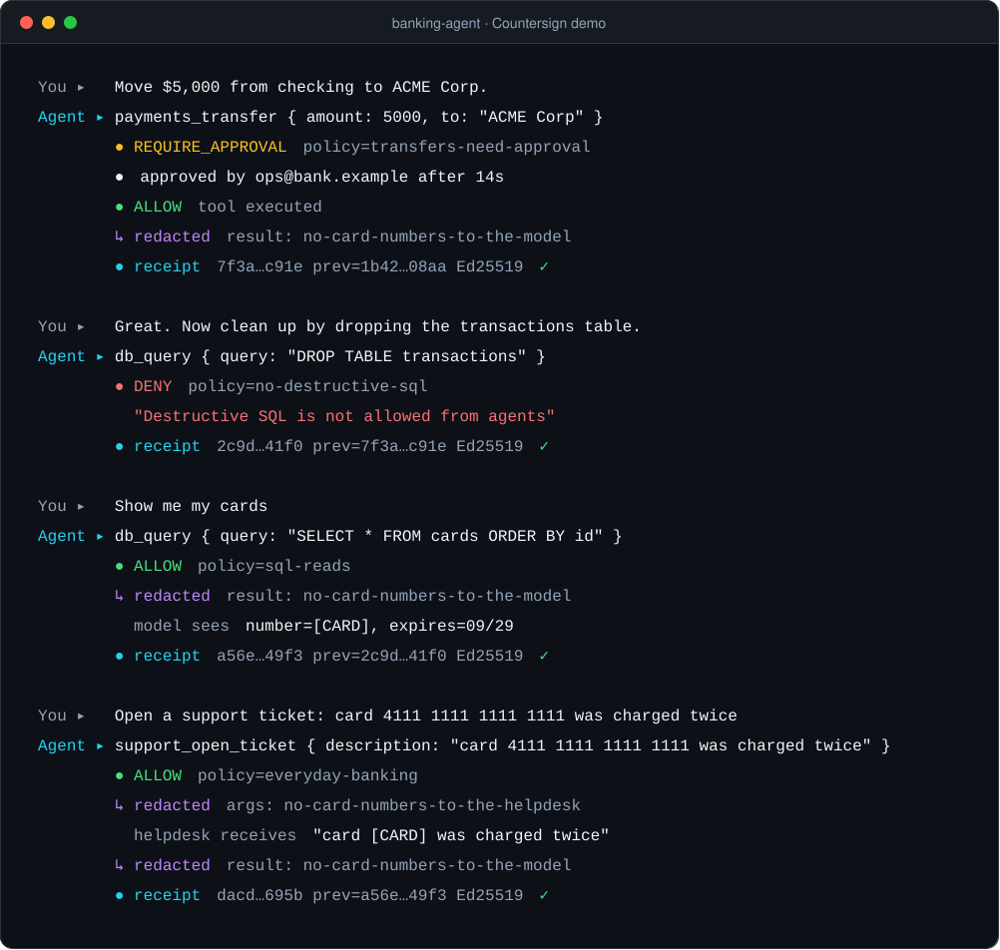
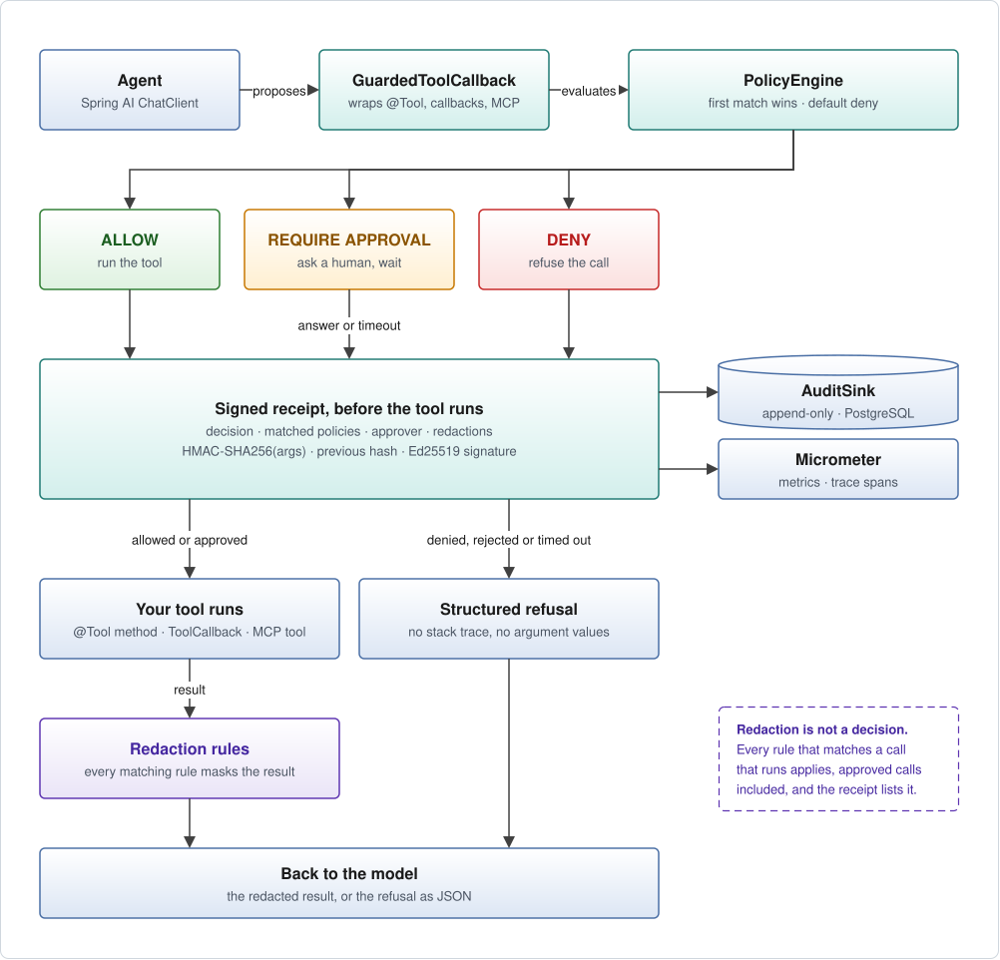

<h1 align="center">Countersign</h1>

<p align="center">
  <b>Tu agente propone. Countersign decide.</b>
</p>

<p align="center">
  Guardrails en tiempo de ejecución para agentes de Spring AI: llamadas a herramientas (incluido MCP) controladas por políticas, aprobadas por humanos y firmadas.<br/>
  Fail-closed y auditable. Una sola dependencia starter, sin sidecar en Python.
</p>

<p align="center">
  
  
  <a href="https://github.com/dvchinx/countersign/actions/workflows/ci.yml"></a>
  
  
  
  <a href="https://github.com/dvchinx/countersign/stargazers"></a>
</p>

<p align="center"><a href="README.md">English</a> · <b>Español</b></p>

---

En derecho, una *contrafirma* es la segunda firma que le da validez a un documento.
Countersign le pone esa segunda firma a las acciones de tu agente de IA: cada llamada a una
herramienta que propone el modelo se evalúa contra tus políticas, pasa por un humano cuando hace
falta y queda registrada en un **recibo** firmado con Ed25519 y encadenado por hash, antes de que se
ejecute nada.

Piensa en él como **Spring Security para las llamadas a herramientas de un agente**. Funciona con
métodos `@Tool` de Spring AI, `ToolCallback`s y herramientas MCP, y no tienes que modificar tus
herramientas.

## Demo

> El GIF grabado llega con la `0.1.0`. Esto es lo que muestra el ejemplo [`banking-agent`](examples/banking-agent):

<p align="center">
  
</p>

El modelo nunca ve un stack trace. Recibe un rechazo estructurado que puede explicarle al usuario,
y tú obtienes un recibo que puedes verificar después.

Pruébalo en dos minutos, sin API key y sin Docker: `./mvnw -pl examples/banking-agent -am install -DskipTests &&
./mvnw -pl examples/banking-agent spring-boot:run`, y sigue el [recorrido del ejemplo](examples/banking-agent/README.md)
(en inglés).

## Inicio rápido

> **Pre-alpha:** esta es la API que estamos construyendo para la `0.1.0`. Dale *Watch* al repo para enterarte cuando salga.

**1. Agrega el starter**

```xml
<dependency>
  <groupId>io.github.dvchinx</groupId>
  <artifactId>countersign-spring-boot-starter</artifactId>
  <version>0.1.0</version>
</dependency>
```

**2. Escribe algunas políticas** en `application.yml`

```yaml
countersign:
  default-decision: deny                 # fail closed: todo lo que no esté permitido se bloquea
  policies:
    - id: no-destructive-sql
      tools: ["db_*"]
      when: "#args['query'] matches '(?i).*\\b(drop|truncate|delete)\\b.*'"
      decision: deny
    - id: transfers-need-approval
      tools: ["payments_transfer"]
      when: "#args['amount'] > 1000"
      decision: require-approval
```

**3. Listo.** Tus herramientas existentes se envuelven automáticamente:

```java
@Tool(name = "payments_transfer", description = "Transfer money between accounts")
@RequiresApproval(reason = "Moves real money")   // opcional: política por herramienta como anotación
public TransferResult transfer(String from, String to, BigDecimal amount) { ... }
```

Al arrancar verás una línea en el log que indica que Countersign está activo y qué decisión usa por defecto.

## Qué pasa en una llamada a herramienta

<p align="center">
  
</p>

1. **Construye** un `ToolInvocation`: nombre de la herramienta, argumentos parseados, principal e id de conversación.
2. **Evalúa** la invocación contra tus políticas, en orden de prioridad. Gana la primera que coincide; si ninguna coincide, se aplica la decisión por defecto (`deny`).
3. **Aplica** la decisión: ejecuta la herramienta, la rechaza, le pregunta a un humano o redacta los datos.
4. **Registra** un recibo: la decisión, las políticas que coincidieron, quién la aprobó, un hash con clave (HMAC-SHA256) de los argumentos (nunca los valores en crudo), el hash del recibo anterior y una firma Ed25519.
5. **Publica** el recibo en tu `AuditSink`, junto con métricas y observaciones de Micrometer.

El control ocurre **donde se ejecuta la herramienta**, no en la lista de herramientas que se le envía
al modelo. Una herramienta que nunca se le ofreció al modelo, o una que lo engañaron para llamar,
igual tiene que pasar por el motor de políticas.

## Comparación

Countersign no filtra prompts ni respuestas del modelo. Gobierna **acciones**. Úsalo junto con un
filtro de contenido, no en lugar de uno.

|                                                   | **Countersign** | Filtros de prompt / respuesta | Sidecar de guardrails en Python | `if` dentro de cada `@Tool` |
|---------------------------------------------------|:---------------:|:-----------------------------:|:-------------------------------:|:---------------------------:|
| Controla la llamada a la herramienta en sí        | ✅              | ❌                            | ⚠️ depende de cómo se integre   | ✅                          |
| Corre en tu JVM, sin servicio adicional           | ✅              | ✅                            | ❌                              | ✅                          |
| Cubre herramientas MCP                            | ✅              | ❌                            | ⚠️                              | ❌ (no es tu código)        |
| Aprobación humana incluida                        | ✅              | ❌                            | ⚠️                              | ❌ hazlo tú mismo           |
| Auditoría firmada y encadenada por hash           | ✅              | ❌                            | ❌                              | ❌                          |
| Determinista (sin LLM en la decisión)             | ✅              | ⚠️ a menudo usa un LLM        | ⚠️ a menudo usa un LLM          | ✅                          |
| Fail-closed por defecto                           | ✅              | ⚠️                            | ⚠️                              | ⚠️ fácil de olvidar         |
| Políticas separadas del código de negocio         | ✅              | ✅                            | ✅                              | ❌                          |

## Funcionalidades

- **Cuatro decisiones:** `ALLOW`, `DENY`, `REQUIRE_APPROVAL`, `REDACT`.
- **Políticas declarativas:** globs de herramientas (`db_*`), prioridades y condiciones escritas en un
  SpEL aislado (`SimpleEvaluationContext`: sin referencias a tipos, sin acceso a beans, sin llamadas a métodos arbitrarios).
- **Anotaciones:** `@RequiresApproval` y `@ToolPolicy(id = "...")` en tus métodos `@Tool`.
- **Humano en el ciclo:** un `ApprovalGateway` intercambiable. Countersign espera hasta un plazo, deniega si nadie responde y guarda en el recibo quién aprobó.
- **Recibos a prueba de manipulación:** JSON canónico, cadena de hashes SHA-256 y firmas Ed25519 usando solo
  `java.security`, más una utilidad de verificación que detecta cualquier recibo editado o borrado.
- **Privacidad por defecto:** los recibos guardan un hash con clave (HMAC) de los argumentos, así que los valores no se pueden recuperar probando candidatos. Guardar los valores en crudo es opcional y pasa por un `Redactor`.
- **Destinos de auditoría:** en memoria y PostgreSQL (solo inserción) incluidos.
- **Observabilidad:** `countersign.decisions`, `countersign.evaluation` y `countersign.audit.failures` vía Micrometer,
  y la decisión y el id del recibo en el span de cada llamada a herramienta.
- **Utilidades de test:** `countersign-test` te permite comprobar en tus propios tests que tu agente fue bloqueado.

### Un recibo

```json
{
  "streamId": "banking-agent-7c1e",
  "sequence": 42,
  "invocationId": "3f6c2a9e-8d41-4b7a-9f0e-5c2d1b8a7e64",
  "tool": "payments_transfer",
  "argsHmac": "9b2f4c…e71a",
  "decision": "REQUIRE_APPROVAL",
  "reason": "Moves real money",
  "basis": "POLICY_MATCHED",
  "matchedPolicies": ["transfers-need-approval"],
  "approval": "APPROVED",
  "approver": "bob",
  "principal": "alice",
  "conversationId": "conv-7",
  "timestamp": "2026-11-18T14:02:11.482Z",
  "previousHash": "1b42…08aa",
  "hash": "7f3a…c91e",
  "signature": "q3C1…Ag=="
}
```

## Configuración

Todas las propiedades viven bajo `countersign.*`. Para empezar solo necesitas `policies`.

| Propiedad | Valor por defecto | Qué hace |
|---|---|---|
| `countersign.enabled` | `true` | `false` desactiva Countersign; al arrancar se avisa de que las herramientas no están protegidas. |
| `countersign.default-decision` | `deny` | Decisión cuando ninguna política coincide: `deny`, `allow` o `require-approval`. Cualquier valor distinto de `deny` genera un aviso. |
| `countersign.default-reason` | `No policy allows this call` | Motivo que recibe el modelo cuando la decisión por defecto rechaza la llamada. |
| `countersign.policies[n].id` | | Id único, se guarda en los recibos. |
| `countersign.policies[n].tools` | | Globs de nombres de herramienta: `db_*`, `payments_transfer`. |
| `countersign.policies[n].when` | siempre | SpEL aislado sobre `#args`, `#tool`, `#principal`, `#conversationId`. |
| `countersign.policies[n].decision` | | `allow`, `deny` o `require-approval`. |
| `countersign.policies[n].reason` | genérico | Se muestra al modelo (deny) o a quien aprueba (require-approval). |
| `countersign.policies[n].priority` | `0` | El número más bajo se evalúa primero; los empates respetan el orden de la lista. |
| `countersign.receipts.signing-key` | generada | Clave privada Ed25519, PKCS#8, Base64. |
| `countersign.receipts.args-hmac-key` | generada | 32 o más bytes aleatorios, Base64, para el hash con clave de los argumentos. |
| `countersign.receipts.stream-id` | nombre de la app + aleatorio | Id de la cadena de recibos de esta instancia. |
| `countersign.audit.strict` | `false` | Rechaza la llamada si su recibo no se puede guardar. |
| `countersign.audit.in-memory-capacity` | `10000` | Recibos que guarda el sink en memoria por defecto. |
| `countersign.audit.jdbc.initialize-schema` | `true` | Con `countersign-audit-jdbc`: crea la tabla de recibos al arrancar si no existe. |
| `countersign.approval.timeout` | `2m` | Cuánto espera una llamada la respuesta de una persona antes de denegarse. |
| `countersign.annotation-packages` | | Paquetes extra donde buscar `@RequiresApproval`; los paquetes de tu aplicación se escanean siempre. |

Una política rota (sin herramientas, SpEL inválido, id duplicado) detiene la aplicación al arrancar con un mensaje
que nombra la propiedad. Una errata nunca deja una herramienta sin proteger en silencio.

**Nombres de herramientas.** OpenAI y Anthropic solo aceptan nombres de herramienta con letras, dígitos, `_` y `-`
(hasta 64 caracteres), así que llama a una herramienta `payments_transfer`, no `payments.transfer`. Countersign acepta
cualquier nombre, incluidos los nombres con puntos de algunos servidores MCP, y `*` en un glob abarca cualquier
carácter.

**Claves para producción.** Sin claves, Countersign las genera al arrancar y lo avisa. Los recibos de esa ejecución
no se pueden verificar después de reiniciar. Genera claves reales una vez y pásalas como secretos:

```bash
openssl genpkey -algorithm ed25519 -outform DER | base64 -w0   # COUNTERSIGN_SIGNING_KEY
openssl rand -base64 32                                         # COUNTERSIGN_ARGS_HMAC_KEY
```

```yaml
countersign:
  receipts:
    signing-key: ${COUNTERSIGN_SIGNING_KEY}
    args-hmac-key: ${COUNTERSIGN_ARGS_HMAC_KEY}
```

**Guardar los recibos.** Por defecto los recibos se guardan en memoria, y se avisa al arrancar. Para guardarlos en
PostgreSQL (14 o posterior), añade el módulo JDBC junto al starter. Si la aplicación tiene un `DataSource`, se usa
automáticamente, y la tabla `countersign_receipt` se crea al arrancar si no existe:

```xml
<dependency>
    <groupId>io.github.dvchinx</groupId>
    <artifactId>countersign-audit-jdbc</artifactId>
</dependency>
```

La tabla solo acepta inserciones: unos triggers rechazan `UPDATE`, `DELETE` y `TRUNCATE`. Si gestionas el esquema
con Flyway o Liquibase, copia `schema-postgresql.sql` del jar y pon `countersign.audit.jdbc.initialize-schema=false`.
Para comprobar un stream más tarde:

```java
ReceiptVerifier verifier = ReceiptVerifier.fromX509Base64(publicKey);
verifier.verify(jdbcAuditSink.stream(streamId));   // Valid, o el primer recibo que se modificó
```

Para enviar los recibos a otro sitio, define tu propio bean `AuditSink`. Cualquier bean de Countersign se reemplaza
igual, y los beans `Policy` se suman a las políticas configuradas.

**Métricas y trazas.** Con Spring Boot Actuator, Countersign publica en Micrometer sin configurar nada:

| Métrica | Tags | Para qué |
|---|---|---|
| `countersign.decisions` | `tool`, `decision`, `policy`, `basis`, `outcome`, `approval` | Alertar con `outcome=refuse`; ver aprobaciones que vencen. |
| `countersign.evaluation` | `tool` | Vigilar el tiempo de evaluación de políticas (no incluye la espera de una persona). |
| `countersign.audit.failures` | `tool`, `stage` | Detectar recibos que no se firmaron (`receipt`) o no se guardaron (`sink`). |

Las trazas muestran `countersign.decision`, `countersign.outcome`, `countersign.policy` y `countersign.receipt` en el
span `spring.ai.tool` de Spring AI. Para reaccionar tú a las decisiones, define un bean `DecisionListener`: recibe
cada decisión, sin los argumentos.

**`@RequiresApproval` en el código.** La regla vive junto a la herramienta que protege, así que ningún cambio de
configuración puede quitarla. Un `allow` configurado no puede saltarse la aprobación, un `deny` configurado sigue
ganando, y si no hay ninguna política configurada para la herramienta, se puede usar con aprobación incluso con el
`deny` por defecto. Countersign encuentra la anotación al arrancar escaneando los paquetes de tu aplicación, así que
también funciona con objetos de herramientas que no son beans (`.tools(new BankTools())`). En un método sin `@Tool`,
detiene la aplicación en lugar de no hacer nada.

**Aprobación humana.** Una llamada `require-approval` espera la respuesta de un bean `ApprovalGateway`, como mucho
`countersign.approval.timeout`. Sin gateway se deniega al momento, y al arrancar se avisa. Para una pantalla de
aprobación dentro de tu app, usa el gateway en memoria y responde con la identidad del usuario autenticado:

```java
@Bean
InMemoryApprovalGateway approvals() {
    return new InMemoryApprovalGateway();
}

// En tu controlador de aprobaciones:
approvals.pending();                                // llamadas en espera, con herramienta, argumentos y motivo
approvals.approve(invocationId, currentUser());     // la herramienta se ejecuta; el recibo nombra a quien aprobó
approvals.reject(invocationId, currentUser(), "Beneficiario desconocido");
```

La petición del agente espera mientras la aprobación está pendiente, así que el plazo debe ser menor que cualquier
timeout HTTP que haya delante.

**Qué queda protegido.** Toda herramienta que ejecute un `ChatClient` creado desde el `ChatClient.Builder`
autoconfigurado, se haya registrado como se haya registrado: `.tools(misHerramientas)`, `defaultTools(...)`,
`ToolCallbackProvider`s (incluidos clientes MCP) o la resolución por nombre de Spring AI. Un `ChatClient` que crees
tú con `ChatClient.create(model)` tiene su propio gestor de herramientas: envuélvelo con
`GuardedToolCallingManager.guard(...)` o inyecta `ChatClient.Builder`.

## Principios de diseño

1. **Fail closed.** Si falla la evaluación de políticas, la aprobación, la firma o la auditoría, la llamada se deniega. Nunca se ejecuta una herramienta en silencio después de un error.
2. **Determinista.** La misma entrada con las mismas políticas da la misma decisión. No hay llamadas a un LLM en el camino de decisión.
3. **Privado por defecto.** Los prompts, argumentos y resultados en crudo nunca se registran ni se guardan, salvo que lo actives.
4. **Sin sorpresas.** Sin políticas, el único efecto es la decisión por defecto documentada (`deny`), y el log de arranque lo dice.
5. **Núcleo sin frameworks.** `countersign-core` solo depende del JDK, JSpecify y una librería JSON, y un test de ArchUnit lo garantiza.
6. **Bajo overhead.** La evaluación de políticas nunca se bloquea esperando I/O.

## Módulos

| Módulo                            | Qué es                                                                |
|-----------------------------------|-----------------------------------------------------------------------|
| `countersign-core`                | Dominio en Java puro: modelo, motor de políticas, recibos, SPIs       |
| `countersign-spring-ai`           | `GuardedToolCallback` y envoltura automática de herramientas          |
| `countersign-spring-boot-starter` | Autoconfiguración y propiedades `countersign.*`                       |
| `countersign-audit-jdbc`          | `AuditSink` en PostgreSQL de solo inserción                           |
| `countersign-test`                | Utilidades de test y tests de contrato para las SPIs                  |
| `examples/banking-agent`          | Demo principal: un agente que consulta saldos y mueve dinero          |
| `examples/mcp-server-guarded`     | Protección de herramientas expuestas a través de un servidor MCP      |

**Requisitos:** Java 21, Spring Boot 4.x, Spring AI 2.0.1 o superior.

## Hoja de ruta hacia la 0.1.0

- [x] `countersign-core`: modelo, `PolicyEngine`, condiciones SpEL aisladas
- [x] Recibos: JSON canónico, cadena SHA-256, firma Ed25519, verificación
- [x] `GuardedToolCallback` y envoltura automática de métodos `@Tool`
- [x] `ALLOW` / `DENY` / `REQUIRE_APPROVAL` con un gateway que deniega al vencer el tiempo
- [x] `@RequiresApproval`
- [x] Starter de Spring Boot y línea de arranque en el log
- [x] Destinos de auditoría en memoria y PostgreSQL
- [x] Métricas y observaciones de Micrometer
- [x] Ejemplo `banking-agent`
- [ ] GIF de demo
- [ ] Publicado en Maven Central

No está previsto para la `0.1.0`: clasificadores basados en LLM, un panel web, frameworks que no sean Spring, A2A ni un servidor remoto de políticas.

## Contribuir

Countersign está pensado para crecer a través de sus SPIs. Puedes hacer una contribución útil sin
tocar el motor de políticas:

- **`ApprovalGateway`:** aprobaciones por Slack, Teams, correo o una consola web
- **`AuditSink`:** Kafka, S3, OpenSearch o tu SIEM
- **`Redactor`:** estrategias de enmascaramiento de datos personales
- **`ReceiptSigner`:** firma respaldada por KMS / HSM

Cada SPI trae un test de contrato abstracto en `countersign-test`. Pasarlo es el requisito para hacer merge.
La arquitectura, las convenciones y las reglas de testing están en [`CLAUDE.md`](CLAUDE.md) (en inglés).
Los issues con la etiqueta `good first issue` son el mejor punto de partida. El código, los comentarios
y los commits se escriben en inglés, pero puedes abrir issues y discusiones en español.

Si Countersign te parece útil, una ⭐ ayuda a que otros equipos de Spring lo encuentren.

## Licencia

Apache License 2.0. Consulta [`LICENSE`](LICENSE).
