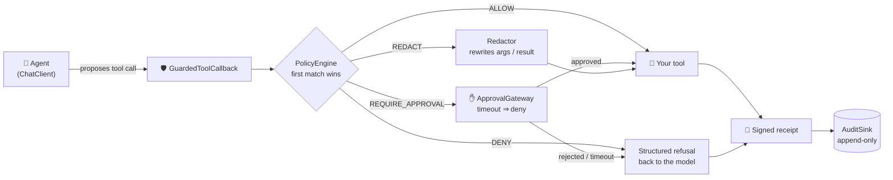

<h1 align="center">Countersign</h1>

<p align="center">
  <b>Your agent proposes. Countersign decides.</b>
</p>

<p align="center">
  Runtime guardrails for Spring AI agents: policy-enforced, human-approved, signed tool calls (incl. MCP).<br/>
  Fail-closed, auditable. One starter dependency, no Python sidecar.
</p>

<p align="center">
  
  
  
  
  
  <a href="https://github.com/dvchinx/countersign/stargazers"></a>
</p>

---

In law, a *countersignature* is the second signature that makes a document valid.
Countersign adds that second signature to your AI agent's actions: every tool call the model
proposes is checked against your policies, sent to a human when it needs one, and recorded in an
Ed25519-signed, hash-chained **receipt** before anything runs.

Think of it as **Spring Security for agent tool calls**. It works with Spring AI `@Tool` methods,
`ToolCallback`s and MCP tools, and you don't have to change your tools.

## Demo

> The recorded GIF ships with `0.1.0`. This is what the [`banking-agent`](examples/banking-agent) example shows:

```text
You   ▸ Move $5,000 from checking to ACME Corp.
Agent ▸ payments.transfer { amount: 5000, to: "ACME Corp" }
        ⏸  REQUIRE_APPROVAL   policy=transfers-need-approval
        ✋  approved by ops@bank.example after 14s
        ✅  ALLOW → tool executed
        🧾  receipt 7f3a…c91e   prev=1b42…08aa   sig=Ed25519 ✓

You   ▸ Great. Now clean up by dropping the transactions table.
Agent ▸ db.query { query: "DROP TABLE transactions" }
        ⛔  DENY   policy=no-destructive-sql   "Destructive SQL is not allowed from agents"
        🧾  receipt 2c9d…41f0   prev=7f3a…c91e   sig=Ed25519 ✓
```

The model never sees a stack trace. It gets a structured refusal it can explain to the user, and
you get a receipt you can verify later.

## Quickstart

> **Pre-alpha:** this is the API we are building toward `0.1.0`. Watch the repo to know when it lands.

**1. Add the starter**

```xml
<dependency>
  <groupId>io.github.dvchinx</groupId>
  <artifactId>countersign-spring-boot-starter</artifactId>
  <version>0.1.0</version>
</dependency>
```

**2. Write a few policies** in `application.yml`

```yaml
countersign:
  default-decision: deny                 # fail closed: anything not allowed is blocked
  policies:
    - id: no-destructive-sql
      tools: ["db.*"]
      when: "#args['query'] matches '(?i).*\\b(drop|truncate|delete)\\b.*'"
      decision: deny
    - id: transfers-need-approval
      tools: ["payments.transfer"]
      when: "#args['amount'] > 1000"
      decision: require-approval
```

**3. That's it.** Your existing tools are wrapped automatically:

```java
@Tool(description = "Transfer money between accounts")
@RequiresApproval(reason = "Moves real money")   // optional: per-tool policy as an annotation
public TransferResult transfer(String from, String to, BigDecimal amount) { ... }
```

On startup you'll see one line telling you Countersign is active and which default it uses.

## What happens on a tool call



1. **Build** a `ToolInvocation`: tool name, parsed arguments, principal, conversation id.
2. **Evaluate** it against your policies, in priority order. The first match wins; if nothing matches, the default (`deny`) applies.
3. **Apply** the decision: run the tool, refuse it, ask a human, or redact it.
4. **Record** a receipt: the decision, the matched policies, a SHA-256 of the arguments (never the raw values), the previous receipt's hash, and an Ed25519 signature.
5. **Publish** it to your `AuditSink`, along with Micrometer metrics and observations.

Enforcement happens **where the tool runs**, not in the list of tools sent to the model. A tool the
model was never offered, or one it was tricked into calling, still has to pass the policy engine.

## How it compares

Countersign does not filter prompts or model output. It governs **actions**. Use it alongside a
content filter, not instead of one.

|                                             | **Countersign** | Prompt / output filters | Python guardrail sidecar | `if` checks inside each `@Tool` |
|---------------------------------------------|:---------------:|:-----------------------:|:------------------------:|:-------------------------------:|
| Enforces at the tool call itself            | ✅              | ❌                      | ⚠️ depends on wiring     | ✅                              |
| Runs in your JVM, no extra service          | ✅              | ✅                      | ❌                       | ✅                              |
| Covers MCP tools                            | ✅              | ❌                      | ⚠️                       | ❌ (not your code)              |
| Human approval built in                     | ✅              | ❌                      | ⚠️                       | ❌ roll your own                |
| Signed, hash-chained audit trail            | ✅              | ❌                      | ❌                       | ❌                              |
| Deterministic (no LLM in the decision path) | ✅              | ⚠️ often LLM-based      | ⚠️ often LLM-based       | ✅                              |
| Fail-closed by default                      | ✅              | ⚠️                      | ⚠️                       | ⚠️ easy to forget               |
| Policies separate from business code        | ✅              | ✅                      | ✅                       | ❌                              |

## Features

- **Four decisions:** `ALLOW`, `DENY`, `REQUIRE_APPROVAL`, `REDACT`.
- **Declarative policies:** tool globs (`db.*`), priorities, and conditions written in a sandboxed SpEL
  (`SimpleEvaluationContext`: no type references, no bean access, no arbitrary method calls).
- **Annotations:** `@RequiresApproval` and `@ToolPolicy(id = "...")` on your `@Tool` methods.
- **Human in the loop:** a pluggable `ApprovalGateway`. The default denies when approval times out.
- **Tamper-evident receipts:** canonical JSON, a SHA-256 hash chain and Ed25519 signatures using only
  `java.security`, plus a verification utility that detects any edited or deleted receipt.
- **Privacy by default:** receipts store a hash of the arguments. Storing raw values is opt-in and goes through a `Redactor`.
- **Audit sinks:** in-memory and PostgreSQL (append-only) out of the box.
- **Observability:** `countersign.decisions`, `countersign.evaluation` and `countersign.audit.failures` via Micrometer.
- **Test helpers:** `countersign-test` lets you assert in your own tests that your agent was blocked.

### A receipt

```json
{
  "invocationId": "01JD6Y3Q8M7K4T2V9X0B5N1C3R",
  "tool": "payments.transfer",
  "argsSha256": "9b2f4c…e71a",
  "decision": "REQUIRE_APPROVAL",
  "matchedPolicies": ["transfers-need-approval"],
  "timestamp": "2026-11-18T14:02:11.482Z",
  "previousHash": "1b42…08aa",
  "hash": "7f3a…c91e",
  "signature": "MEUCIQ…"
}
```

## Design principles

1. **Fail closed.** If policy evaluation, approval, signing or auditing fails, the call is denied. A tool is never run silently after an error.
2. **Deterministic.** The same input and the same policies give the same decision. There are no LLM calls in the decision path.
3. **Private by default.** Raw prompts, arguments and results are never logged or persisted unless you opt in.
4. **No surprises.** With no policies, the only effect is the documented default (`deny`), and the startup log says so.
5. **Framework-free core.** `countersign-core` depends only on the JDK, JSpecify and a JSON library, and an ArchUnit test enforces it.
6. **Low overhead.** Policy evaluation never blocks on I/O.

## Modules

| Module                            | What it is                                                         |
|-----------------------------------|--------------------------------------------------------------------|
| `countersign-core`                | Pure Java domain: model, policy engine, receipts, SPIs             |
| `countersign-spring-ai`           | `GuardedToolCallback` and automatic wrapping of tools              |
| `countersign-spring-boot-starter` | Auto-configuration and `countersign.*` properties                  |
| `countersign-audit-jdbc`          | Append-only PostgreSQL `AuditSink`                                 |
| `countersign-test`                | Test helpers and SPI contract tests                                |
| `examples/banking-agent`          | Flagship demo: an agent that reads balances and moves money        |
| `examples/mcp-server-guarded`     | Guarding tools exposed through an MCP server                       |

**Requirements:** Java 21, Spring Boot 4.x, Spring AI 2.0.1 or later.

## Roadmap to 0.1.0

- [ ] `countersign-core`: model, `PolicyEngine`, sandboxed SpEL conditions
- [ ] Receipts: canonical JSON, SHA-256 chain, Ed25519 signing, verification
- [ ] `GuardedToolCallback` and automatic wrapping of `@Tool` methods
- [ ] `ALLOW` / `DENY` / `REQUIRE_APPROVAL` with a deny-on-timeout gateway
- [ ] `@RequiresApproval`
- [ ] Spring Boot starter and startup banner line
- [ ] In-memory and PostgreSQL audit sinks
- [ ] Micrometer metrics and observations
- [ ] `banking-agent` example and demo GIF
- [ ] Published to Maven Central

Not planned for `0.1.0`: LLM-based classifiers, a UI dashboard, non-Spring frameworks, A2A, or a remote policy server.

## Contributing

Countersign is meant to grow through its SPIs. You can make a useful contribution without
touching the policy engine:

- **`ApprovalGateway`:** Slack, Teams, email or a web console approver
- **`AuditSink`:** Kafka, S3, OpenSearch, or your SIEM
- **`Redactor`:** PII masking strategies
- **`ReceiptSigner`:** KMS / HSM-backed signing

Each SPI comes with an abstract contract test in `countersign-test`. Passing it is the bar for merging.
Architecture, conventions and testing rules are in [`CLAUDE.md`](CLAUDE.md). Issues labelled
`good first issue` are the best place to start.

If Countersign looks useful to you, a ⭐ helps other Spring teams find it.

## License

Apache License 2.0.
