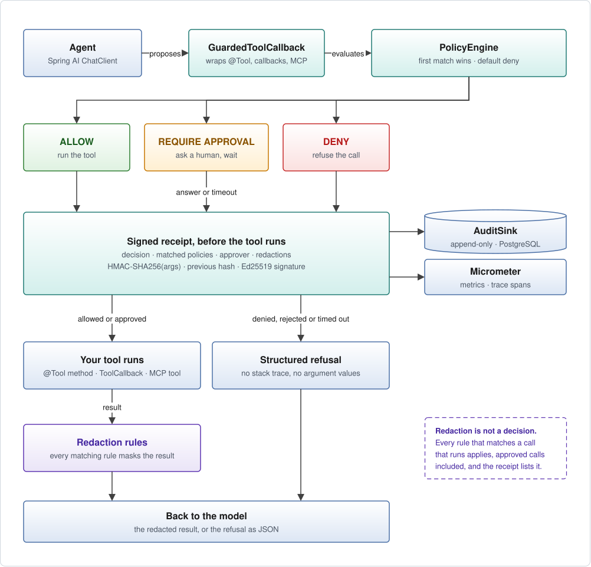

<h1 align="center">Countersign</h1>

<p align="center">
  <b>Your agent proposes. Countersign decides.</b>
</p>

<p align="center">
  Runtime guardrails for Spring AI agents: policy-enforced, human-approved, signed tool calls (incl. MCP).<br/>
  Fail-closed, auditable. One starter dependency, no Python sidecar.
</p>

<p align="center">
  
  
  <a href="https://github.com/dvchinx/countersign/actions/workflows/ci.yml"></a>
  
  
  
  <a href="https://github.com/dvchinx/countersign/stargazers"></a>
</p>

<p align="center"><b>English</b> · <a href="README.es.md">Español</a></p>

---

In law, a *countersignature* is the second signature that makes a document valid.
Countersign adds that second signature to your AI agent's actions: every tool call the model
proposes is checked against your policies, sent to a human when it needs one, and recorded in an
Ed25519-signed, hash-chained **receipt** before anything runs.

Think of it as **Spring Security for agent tool calls**. It works with Spring AI `@Tool` methods,
`ToolCallback`s and MCP tools, and you don't have to change your tools.

## Demo

The [`banking-agent`](examples/banking-agent) example, recorded as it runs:

<p align="center">
  
</p>

[Still diagram of the same flow](docs/images/banking-demo.drawio.svg).

The model never sees a stack trace. It gets a structured refusal it can explain to the user, and
you get a receipt you can verify later.

Try it yourself in two minutes, with no API key and no Docker: `./mvnw -pl examples/banking-agent -am install
-DskipTests && ./mvnw -pl examples/banking-agent spring-boot:run`, then follow the
[example's walkthrough](examples/banking-agent/README.md).

## Quickstart

> **Pre-alpha:** this is the API we are building toward `0.1.0`. Watch the repo to know when it lands.

**1. Add the starter**

```xml
<dependency>
  <groupId>io.github.dvchinx</groupId>
  <artifactId>countersign-spring-boot-starter</artifactId>
  <version>0.1.0</version>
</dependency>
```

**2. Write a few policies** in `application.yml`

```yaml
countersign:
  default-decision: deny                 # fail closed: anything not allowed is blocked
  policies:
    - id: no-destructive-sql
      tools: ["db_*"]
      when: "#args['query'] matches '(?i).*\\b(drop|truncate|delete)\\b.*'"
      decision: deny
    - id: transfers-need-approval
      tools: ["payments_transfer"]
      when: "#args['amount'] > 1000"
      decision: require-approval
```

**3. That's it.** Your existing tools are wrapped automatically:

```java
@Tool(name = "payments_transfer", description = "Transfer money between accounts")
@RequiresApproval(reason = "Moves real money")   // optional: per-tool policy as an annotation
public TransferResult transfer(String from, String to, BigDecimal amount) { ... }
```

On startup you'll see one line telling you Countersign is active and which default it uses.

## What happens on a tool call

<p align="center">
  
</p>

1. **Build** a `ToolInvocation`: tool name, parsed arguments, principal, conversation id.
2. **Evaluate** it against your policies, in priority order. The first match wins; if nothing matches, the default (`deny`) applies.
3. **Apply** the decision: run the tool, refuse it, ask a human, or redact it.
4. **Record** a receipt: the decision, the matched policies, who approved it, a keyed hash (HMAC-SHA256) of the arguments (never the raw values), the previous receipt's hash, and an Ed25519 signature.
5. **Publish** it to your `AuditSink`, along with Micrometer metrics and observations.

Enforcement happens **where the tool runs**, not in the list of tools sent to the model. A tool the
model was never offered, or one it was tricked into calling, still has to pass the policy engine.

## How it compares

Countersign does not filter prompts or model output. It governs **actions**. Use it alongside a
content filter, not instead of one.

|                                             | **Countersign** | Prompt / output filters | Python guardrail sidecar | `if` checks inside each `@Tool` |
|---------------------------------------------|:---------------:|:-----------------------:|:------------------------:|:-------------------------------:|
| Enforces at the tool call itself            | ✅              | ❌                      | ⚠️ depends on wiring     | ✅                              |
| Runs in your JVM, no extra service          | ✅              | ✅                      | ❌                       | ✅                              |
| Covers MCP tools                            | ✅              | ❌                      | ⚠️                       | ❌ (not your code)              |
| Human approval built in                     | ✅              | ❌                      | ⚠️                       | ❌ roll your own                |
| Signed, hash-chained audit trail            | ✅              | ❌                      | ❌                       | ❌                              |
| Deterministic (no LLM in the decision path) | ✅              | ⚠️ often LLM-based      | ⚠️ often LLM-based       | ✅                              |
| Fail-closed by default                      | ✅              | ⚠️                      | ⚠️                       | ⚠️ easy to forget               |
| Policies separate from business code        | ✅              | ✅                      | ✅                       | ❌                              |

## Features

- **Four decisions:** `ALLOW`, `DENY`, `REQUIRE_APPROVAL`, `REDACT`.
- **Declarative policies:** tool globs (`db_*`), priorities, and conditions written in a sandboxed SpEL
  (`SimpleEvaluationContext`: no type references, no bean access, no arbitrary method calls).
- **Annotations:** `@RequiresApproval` and `@ToolPolicy(id = "...")` on your `@Tool` methods.
- **Human in the loop:** a pluggable `ApprovalGateway`. Countersign waits up to a timeout, denies if nobody answers, and records the approver in the receipt.
- **Tamper-evident receipts:** canonical JSON, a SHA-256 hash chain and Ed25519 signatures using only
  `java.security`, plus a verification utility that detects any edited or deleted receipt.
- **Privacy by default:** receipts store a keyed hash (HMAC) of the arguments, so values cannot be recovered by guessing. Storing raw values is opt-in and goes through a `Redactor`.
- **Audit sinks:** in-memory and PostgreSQL (append-only) out of the box.
- **Observability:** `countersign.decisions`, `countersign.evaluation` and `countersign.audit.failures` via Micrometer,
  and the decision and receipt id on each tool call's trace span.
- **Test helpers:** `countersign-test` lets you assert in your own tests that your agent was blocked.

### A receipt

```json
{
  "streamId": "banking-agent-7c1e",
  "sequence": 42,
  "invocationId": "3f6c2a9e-8d41-4b7a-9f0e-5c2d1b8a7e64",
  "tool": "payments_transfer",
  "argsHmac": "9b2f4c…e71a",
  "decision": "REQUIRE_APPROVAL",
  "reason": "Moves real money",
  "basis": "POLICY_MATCHED",
  "matchedPolicies": ["transfers-need-approval"],
  "approval": "APPROVED",
  "approver": "bob",
  "principal": "alice",
  "conversationId": "conv-7",
  "timestamp": "2026-11-18T14:02:11.482Z",
  "previousHash": "1b42…08aa",
  "hash": "7f3a…c91e",
  "signature": "q3C1…Ag=="
}
```

## Configuration

All properties live under `countersign.*`. Only `policies` is needed to get started.

| Property | Default | What it does |
|---|---|---|
| `countersign.enabled` | `true` | `false` turns Countersign off; startup logs a warning that tools are not guarded. |
| `countersign.default-decision` | `deny` | Decision when no policy matches: `deny`, `allow` or `require-approval`. Anything but `deny` is logged as a warning. |
| `countersign.default-reason` | `No policy allows this call` | Reason the model gets when the default decision refuses a call. |
| `countersign.policies[n].id` | | Unique id, recorded in receipts. |
| `countersign.policies[n].tools` | | Tool name globs: `db_*`, `payments_transfer`. |
| `countersign.policies[n].when` | always | Sandboxed SpEL over `#args`, `#tool`, `#principal`, `#conversationId`. |
| `countersign.policies[n].decision` | | `allow`, `deny` or `require-approval`. |
| `countersign.policies[n].reason` | generic | Shown to the model (deny) or the approver (require-approval). |
| `countersign.policies[n].priority` | `0` | Lower runs first; ties keep the order listed. |
| `countersign.receipts.signing-key` | generated | Ed25519 private key, PKCS#8, Base64. |
| `countersign.receipts.args-hmac-key` | generated | 32+ random bytes, Base64, for the keyed hash of arguments. |
| `countersign.receipts.stream-id` | app name + random | Receipt chain id for this instance. |
| `countersign.audit.strict` | `false` | Refuse the call when its receipt cannot be stored. |
| `countersign.audit.in-memory-capacity` | `10000` | Receipts kept by the default in-memory sink. |
| `countersign.audit.jdbc.initialize-schema` | `true` | With `countersign-audit-jdbc`: create the receipts table at startup if it is missing. |
| `countersign.approval.timeout` | `2m` | How long a call waits for a human answer before it is denied. |
| `countersign.annotation-packages` | | Extra packages scanned for `@RequiresApproval`; your application's packages are always scanned. |

A broken policy (missing tool, bad SpEL, duplicate id) stops the application at startup with a message that names
the property. A typo never leaves a tool silently unguarded.

**Tool names.** OpenAI and Anthropic only accept tool names made of letters, digits, `_` and `-` (up to 64
characters), so name a tool `payments_transfer`, not `payments.transfer`. Countersign accepts any name, including the
dotted names some MCP servers use, and `*` in a glob matches any characters.

**Keys for production.** Without keys, Countersign generates them at startup and says so in a warning. Receipts
from that run cannot be verified after a restart. Generate real keys once and pass them as secrets:

```bash
openssl genpkey -algorithm ed25519 -outform DER | base64 -w0   # COUNTERSIGN_SIGNING_KEY
openssl rand -base64 32                                         # COUNTERSIGN_ARGS_HMAC_KEY
```

```yaml
countersign:
  receipts:
    signing-key: ${COUNTERSIGN_SIGNING_KEY}
    args-hmac-key: ${COUNTERSIGN_ARGS_HMAC_KEY}
```

**Storing receipts.** Receipts are kept in memory by default, and startup warns about it. To keep them in
PostgreSQL (14 or later), add the JDBC module next to the starter. With a `DataSource` in the application, it is
used automatically, and the `countersign_receipt` table is created at startup if it is missing:

```xml
<dependency>
    <groupId>io.github.dvchinx</groupId>
    <artifactId>countersign-audit-jdbc</artifactId>
</dependency>
```

The table only accepts inserts: triggers reject `UPDATE`, `DELETE` and `TRUNCATE`. If you manage the schema with
Flyway or Liquibase, copy `schema-postgresql.sql` from the jar and set
`countersign.audit.jdbc.initialize-schema=false`. To check a stream later:

```java
ReceiptVerifier verifier = ReceiptVerifier.fromX509Base64(publicKey);
verifier.verify(jdbcAuditSink.stream(streamId));   // Valid, or the first receipt that was changed
```

To send receipts somewhere else, define your own `AuditSink` bean. Any Countersign bean can be replaced the same
way, and `Policy` beans are added to the configured policies.

**Metrics and tracing.** With Spring Boot Actuator, Countersign publishes to Micrometer with no configuration:

| Meter | Tags | Use it to |
|---|---|---|
| `countersign.decisions` | `tool`, `decision`, `policy`, `basis`, `outcome`, `approval` | Alert on `outcome=refuse`; see approvals that time out. |
| `countersign.evaluation` | `tool` | Watch policy evaluation time (waiting for a human is not included). |
| `countersign.audit.failures` | `tool`, `stage` | Catch receipts that were not signed (`receipt`) or not stored (`sink`). |

Traces show `countersign.decision`, `countersign.outcome`, `countersign.policy` and `countersign.receipt` on Spring
AI's `spring.ai.tool` span. To react to decisions yourself, define a `DecisionListener` bean: it gets every decision,
without the arguments.

**`@RequiresApproval` in code.** The rule lives next to the tool it protects, so no configuration change can drop it.
A configured `allow` cannot skip the approval, a configured `deny` still wins, and with no configured policy for the
tool it is usable with approval even under the default `deny`. Countersign finds the annotation at startup by
scanning your application's packages, so it also works for tool objects that are not beans
(`.tools(new BankTools())`). On a method without `@Tool`, it stops the application instead of doing nothing.

**Human approval.** A `require-approval` call waits for an `ApprovalGateway` bean, up to
`countersign.approval.timeout`. Without a gateway it is denied at once, and startup warns about it. For an approval
screen inside your app, use the in-memory gateway and answer with the identity of the logged-in user:

```java
@Bean
InMemoryApprovalGateway approvals() {
    return new InMemoryApprovalGateway();
}

// In your approval controller:
approvals.pending();                                // calls waiting, with tool, arguments and reason
approvals.approve(invocationId, currentUser());     // the tool runs; the receipt names the approver
approvals.reject(invocationId, currentUser(), "Unknown payee");
```

The agent's request waits while the approval is pending, so keep the timeout below any HTTP timeout in front of it.

**What is guarded.** Every tool run by a `ChatClient` from the auto-configured `ChatClient.Builder`, however the tool
was registered: `.tools(myTools)`, `defaultTools(...)`, `ToolCallbackProvider`s (MCP clients included), or Spring
AI's resolution by name. A `ChatClient` you build yourself with `ChatClient.create(model)` has its own tool manager:
wrap it with `GuardedToolCallingManager.guard(...)`, or inject `ChatClient.Builder` instead.

## Design principles

1. **Fail closed.** If policy evaluation, approval, signing or auditing fails, the call is denied. A tool is never run silently after an error.
2. **Deterministic.** The same input and the same policies give the same decision. There are no LLM calls in the decision path.
3. **Private by default.** Raw prompts, arguments and results are never logged or persisted unless you opt in.
4. **No surprises.** With no policies, the only effect is the documented default (`deny`), and the startup log says so.
5. **Framework-free core.** `countersign-core` depends only on the JDK, JSpecify and a JSON library, and an ArchUnit test enforces it.
6. **Low overhead.** Policy evaluation never blocks on I/O.

## Modules

| Module                            | What it is                                                         |
|-----------------------------------|--------------------------------------------------------------------|
| `countersign-core`                | Pure Java domain: model, policy engine, receipts, SPIs             |
| `countersign-spring-ai`           | `GuardedToolCallback` and automatic wrapping of tools              |
| `countersign-spring-boot-starter` | Auto-configuration and `countersign.*` properties                  |
| `countersign-audit-jdbc`          | Append-only PostgreSQL `AuditSink`                                 |
| `countersign-test`                | Test helpers and SPI contract tests                                |
| `examples/banking-agent`          | Flagship demo: an agent that reads balances and moves money        |
| `examples/mcp-server-guarded`     | Guarding tools exposed through an MCP server                       |

**Requirements:** Java 21, Spring Boot 4.x, Spring AI 2.0.1 or later.

## Roadmap to 0.1.0

- [x] `countersign-core`: model, `PolicyEngine`, sandboxed SpEL conditions
- [x] Receipts: canonical JSON, SHA-256 chain, Ed25519 signing, verification
- [x] `GuardedToolCallback` and automatic wrapping of `@Tool` methods
- [x] `ALLOW` / `DENY` / `REQUIRE_APPROVAL` with a deny-on-timeout gateway
- [x] `@RequiresApproval`
- [x] Spring Boot starter and startup banner line
- [x] In-memory and PostgreSQL audit sinks
- [x] Micrometer metrics and observations
- [x] `banking-agent` example
- [x] Demo GIF
- [ ] Published to Maven Central

Not planned for `0.1.0`: LLM-based classifiers, a UI dashboard, non-Spring frameworks, A2A, or a remote policy server.

## Contributing

Countersign is meant to grow through its SPIs. You can make a useful contribution without
touching the policy engine:

- **`ApprovalGateway`:** Slack, Teams, email or a web console approver
- **`AuditSink`:** Kafka, S3, OpenSearch, or your SIEM
- **`ReceiptSigner`:** KMS / HSM-backed signing

Passing the port's contract test in `countersign-test` is the bar for merging (`AuditSinkContract` today;
contracts for the other ports are good first contributions). Start with [`CONTRIBUTING.md`](CONTRIBUTING.md);
issues labelled `good first issue` are the best place to begin. To report a vulnerability, see
[`SECURITY.md`](SECURITY.md).

If Countersign looks useful to you, a ⭐ helps other Spring teams find it.

## License

Apache License 2.0. See [`LICENSE`](LICENSE).
